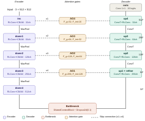

# Mini-U-Net face parsing

**Low-data, low-parameter face parsing on CelebAMask-HQ: 1.82M parameters, trained
from scratch on 1,000 images.**

## TL;DR

This project was created for a university project. The published repo is a cleaned up version, evaluated on the public FaceParsing dataset. The published project uses different images than the course set - so it was retrained and re-evaluated - to comply with course policies. 
 

## Intro

A compact encoder-decoder network for pixel-wise segmentation of face images into
19 classes (skin, eyes, brows, ears, lips, hair, accessories, clothing and so on). It
stays under a hard limit of 1,821,085 trainable parameters and uses no pre-trained
weights. For comparison, the parameter-efficient FP-LIIF [6] uses 2.29M parameters
trained on all 24,183 training images.

## Setting

| | |
| --- | --- |
| Data | [CelebAMask-HQ](https://github.com/switchablenorms/CelebAMask-HQ), official split (24,183 train / 2,993 val / 2,824 test), 512×512 |
| Low-data protocol | 1,000 images drawn from the official **train** split (900 train / 100 validation) |
| Full-data protocol | all 24,183 train images, checkpoint selected on the 2,993 val images |
| Evaluation | all 2,824 official test images, never used for training or model selection |
| Classes | 19 (background, skin and 17 facial parts, accessories and clothing) |
| Budget | at most **1,821,085** trainable parameters, no pre-trained weights |
| Model size | **1,818,398** parameters (checked by `tests/test_model.py`) |
| Metric | per-class F1 pooled over the test set, averaged over the 18 non-background classes |

## Method

The network follows the U-Net topology [1]: a four-level encoder and a symmetric
decoder linked by skip connections. It builds on Manivannan's
[Mini-semantic-segmentation-network](https://github.com/iswariyam/Mini-semantic-segmentation-network-pytorch).
Every block was chosen to buy accuracy cheaply in parameters.

- **Depthwise-separable convolution** [4]. Each 3×3 convolution is factorised into a
  per-channel 3×3 depthwise step and a 1×1 pointwise projection. This is what makes
  a 512-channel bottleneck affordable under the budget.
- **Residual lightweight block (RLConv).** Two DSConv-BatchNorm-ReLU layers, with the
  outputs summed (`x1 + x2`) for an easy gradient path, followed by CBAM.
- **CBAM** [2]. Channel attention (global average pooling, a two-layer MLP with
  reduction 16, sigmoid), then spatial attention (channel-wise mean and max, a 7×7
  convolution, sigmoid). It re-weights features at almost no parameter cost.
- **Dilated context block.** At the 512-channel bottleneck it adds three depthwise 3×3
  convolutions with dilation 1, 2 and 4 to the input, which aggregates multi-scale
  context. It is followed by Dropout2d(0.1).
- **Attention gates** [3] on every skip connection. A sigmoid spatial mask, computed
  from the decoder signal *g* and the encoder features *x* through 1×1 projections,
  suppresses irrelevant encoder activations before concatenation.

<p align="center">
  
</p>

| Stage | Block | Channels | Resolution |
| --- | --- | --- | --- |
| inc | RLConv + CBAM | 32 | 512 × 512 |
| down1 | MaxPool + RLConv + CBAM | 64 | 256 × 256 |
| down2 | MaxPool + RLConv + CBAM | 128 | 128 × 128 |
| down3 | MaxPool + RLConv + CBAM | 256 | 64 × 64 |
| down4 | MaxPool + RLConv + CBAM | 512 | 32 × 32 |
| Bottleneck | DilatedContextBlock + Dropout2d | 512 | 32 × 32 |
| up1 + refine | ConvTranspose2d + AG1 + RLConv | 256 | 64 × 64 |
| up2 | ConvTranspose2d + AG2 + RLConv | 128 | 128 × 128 |
| up3 | ConvTranspose2d + AG3 + RLConv | 64 | 256 × 256 |
| up4 | ConvTranspose2d + AG4 + RLConv | 32 | 512 × 512 |
| outc | Conv 1 × 1 | 19 | 512 × 512 |

**Loss.** Weighted cross-entropy plus weighted soft Dice, with the same class weights
*w* in both terms. Small, rare classes would otherwise be ignored. The weights come
in three groups, tuned with Optuna (10 trials of 10 epochs each) on the validation split:

| Group | Classes | Weight |
| --- | --- | --- |
| Background | 0 | 0.248 |
| Normal features | 1-14, 17-18 | 1.564 |
| Rare/small features | 15 (earrings), 16 (necklace) | 11.877 |

**Augmentation** (training only, applied identically to image and mask):
- horizontal flip, p = 0.5, swapping the left/right labels (4↔5, 6↔7, 8↔9);
- rotation, p = 0.5, uniform in [−10°, +10°], bilinear for the image and nearest for the mask;
- elastic deformation, p = 0.3, α = 150, σ = 15.

**Training.** AdamW (lr 1e-3, weight decay 1e-4), cosine annealing with warm restarts
(T₀ = 15, T_mult = 2, stepped per epoch), batch size 4, mixed precision. The low-data
run trains for 105 epochs, the full-data run for 15. The checkpoint with the best
validation F-measure is kept.

**Test-time augmentation.** At inference, the model also sees the horizontally flipped
image. Those logits are flipped back, the left/right channels are swapped, and the
two sets of logits are averaged.

## Results

Official CelebAMask-HQ test split (2,824 images), mean F1 without background:

| Training data | Config | TTA off | Flip TTA |
| --- | --- | --- | --- |
| 1,000 images | `configs/default.yaml` | – | – |
| 24,183 images | `configs/official.yaml` | – | – |

**Comparison with published results** on the official split and the same metric.
Numbers and parameter counts are as reported in the FP-LIIF paper [6], Tables 2 and 4.

| Method | Parameters | Training images | Input | Mean F1 |
| --- | --- | --- | --- | --- |
| Wei et al. (real-time) | not reported | 24,183 | – | 82.05 |
| EAGR | 66.72M | 24,183 | – | 85.14 |
| DML-CSR | 59.67M | 24,183 | – | 86.07 |
| FP-LIIF [6] | 2.29M | 24,183 | 256 × 256 | 86.07 |
| **Mini-U-Net (this repository)** | **1.82M** | 1,000 / 24,183 | 512 × 512 | see above |

## Ablation

`scripts/ablate.py` retrains the model with one component switched off at a time
(`use_cbam`, `use_attention_gates`, `use_dilated_context`, `use_dice_loss`,
`use_class_weights`, `aug_flip`, `aug_rotate`, `aug_elastic`), and evaluates the full
model with and without TTA. Removing an architectural module replaces it with an
identity, so **the parameter count of those runs is lower than 1,818,398**. The count
is recorded in the summary CSV.

## Reproducing

```bash
# 1. Build the official split from the CelebAMask-HQ download (images resized to 512)
python scripts/prepare_official.py --root path/to/CelebAMask-HQ --out dataset_official --image-size 512

# 2a. Low-data run: 1,000 images from the official train split
python -m miniunet.train --config configs/default.yaml

# 2b. Full-data run: all 24,183 training images
python -m miniunet.train --config configs/official.yaml

# 3. Evaluate on the official test split (dataset-level F1, per-class table)
python -m miniunet.evaluate --checkpoint outputs/default/best.pth \
    --images dataset_official/test/images --masks dataset_official/test/masks --per-class
```

The split is the one of the release's `face_parsing/Data_preprocessing/g_partition.py`,
which papers report: thresholds on `orig_idx` in `CelebA-HQ-to-CelebA-mapping.txt`. Pass
`--partition list_eval_partition.txt` to use CelebA's own partition (off by one image).
`prepare_official.py` prints the split sizes so they can be checked.

`data.train_limit` sets the size of the training subset (1,000 in `default.yaml`, all
images in `official.yaml`); set it to, for example, 5000 for a data-scaling run.

## Notes and limitations

- **Validation metric.** During training, the F-measure is computed per batch of 4
  images (classes pooled over the batch) and averaged over batches. `miniunet.evaluate`
  reports this number, the per-image average and the dataset-level F1 side by side;
  only the dataset-level F1 is comparable with published results.
- **Optimistic validation score.** The loss weights and the checkpoint are both
  selected on the same validation split, so the validation score is slightly
  optimistic. The test-split scores are unbiased.
- **Prior work.** The architecture builds on Manivannan's
  [Mini-semantic-segmentation-network-pytorch](https://github.com/iswariyam/Mini-semantic-segmentation-network-pytorch),
  with ideas from U-Net [1], CBAM [2] and Attention U-Net [3].
- **No data or weights here.** CelebAMask-HQ is for non-commercial research only and
  shows real people, so no images or masks are in this repository. Trained weights
  are available on request.

## Quick start

```bash
pip install -r requirements.txt
pip install -e .          # makes `python -m miniunet.*` available
```

**Dataset.** Download CelebAMask-HQ from the links on the
[official page](https://github.com/switchablenorms/CelebAMask-HQ) and build the
official split with `scripts/prepare_official.py` (see [Reproducing](#reproducing)).
To train on your own data, point `data.train_images` and `data.train_masks` in the
config to folders laid out like this:

```
images/   00001.jpg ...   RGB face images
masks/    00001.png ...   single-channel label maps, pixel value = class id 0..18
```

Each mask has the same name as its image, with `.jpg` replaced by `.png`.

```bash
# Train (checkpoints and history.csv in outputs/default/)
python -m miniunet.train --config configs/default.yaml

# Validation F-measure of a checkpoint, with and without TTA
python -m miniunet.evaluate --config configs/default.yaml --checkpoint outputs/default/best.pth

# Predict masks at the original image size, with flip TTA
python -m miniunet.predict --checkpoint outputs/default/best.pth \
    --input-dir dataset_official/test/images --output-dir predictions --tta

# Re-run the Optuna search over the loss weights
python -m miniunet.tune_weights --config configs/default.yaml

# Ablation: one training per switched-off component, summary in outputs/ablation/summary.csv
python scripts/ablate.py --config configs/default.yaml

# Plot training curves (needs matplotlib)
python scripts/plot_history.py outputs/default/history.csv --out docs/training_curves.png
```

**Tests.** `pytest` checks the parameter count (exactly 1,818,398) and the output
shape. It also checks the flip-label swap and TTA consistency, and that Dice loss is
zero for a perfect prediction. It runs one training epoch, prediction with TTA and
evaluation on a randomly generated dummy dataset. The official-split tools (mask
merging, split, dataset-level F1) are tested on a tiny fake CelebAMask-HQ download.

Code is formatted with `black` and linted with `ruff` (settings in `pyproject.toml`).

## Repository layout

```
configs/default.yaml      low-data run: 1,000 images from the official train split
configs/official.yaml     full-data run: all official training images
src/miniunet/model.py     building blocks and MiniUNet
src/miniunet/celebamask.py  official label order, split and mask merging
src/miniunet/data.py      dataset, augmentation, subset and train/validation split
src/miniunet/losses.py    weighted Dice loss, CE + Dice builder
src/miniunet/metrics.py   per-image F-measure and dataset-level F1
src/miniunet/train.py     training CLI
src/miniunet/evaluate.py  evaluation CLI (validation split or any folder)
src/miniunet/predict.py   inference CLI with optional flip TTA
src/miniunet/tune_weights.py  Optuna loss-weight search
scripts/ablate.py         ablation runs
scripts/plot_history.py   training curves
scripts/prepare_official.py  official train/val/test folders from the download
tests/                    unit and end-to-end smoke tests
```

## Credits

Claude Code was used as a coding assistant and for cleaning up the repo.

## References

1. O. Ronneberger, P. Fischer, T. Brox. *U-Net: Convolutional Networks for Biomedical Image Segmentation.* MICCAI 2015.
2. S. Woo, J. Park, J.-Y. Lee, I. S. Kweon. *CBAM: Convolutional Block Attention Module.* ECCV 2018.
3. O. Oktay et al. *Attention U-Net: Learning Where to Look for the Pancreas.* MIDL 2018 (arXiv:1804.03999).
4. A. G. Howard et al. *MobileNets: Efficient Convolutional Neural Networks for Mobile Vision Applications.* arXiv:1704.04861, 2017.
5. C.-H. Lee, Z. Liu, L. Wu, P. Luo. *MaskGAN: Towards Diverse and Interactive Facial Image Manipulation.* CVPR 2020 (CelebAMask-HQ).
6. M. Sarkar, N. SR, M. Hemani, R. Jain, B. Krishnamurthy. *Parameter Efficient Local Implicit Image Function Network for Face Segmentation.* CVPR 2023 (arXiv:2303.15122).

## License

Code: MIT (see `LICENSE`). The CelebAMask-HQ dataset has its own non-commercial research license.
